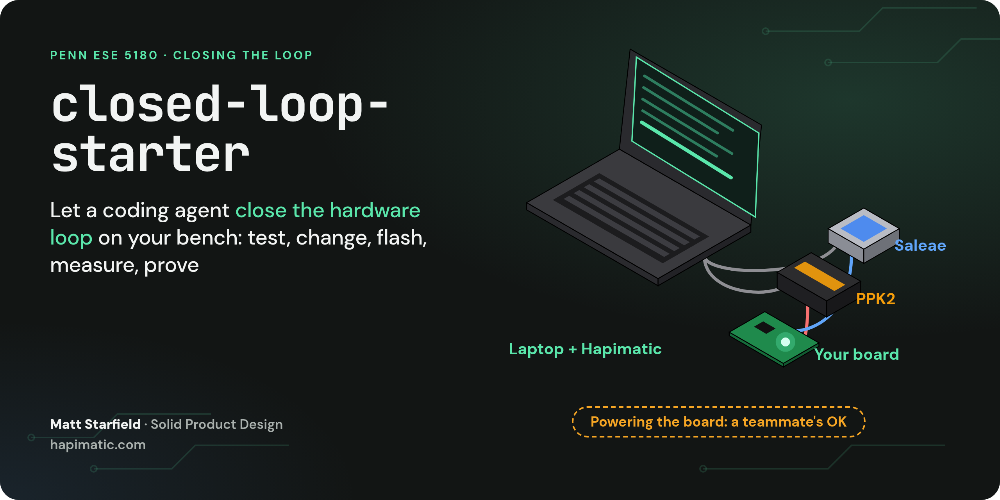
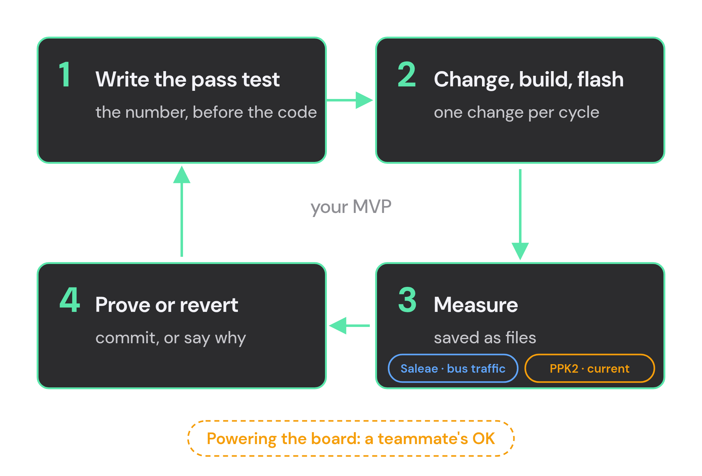
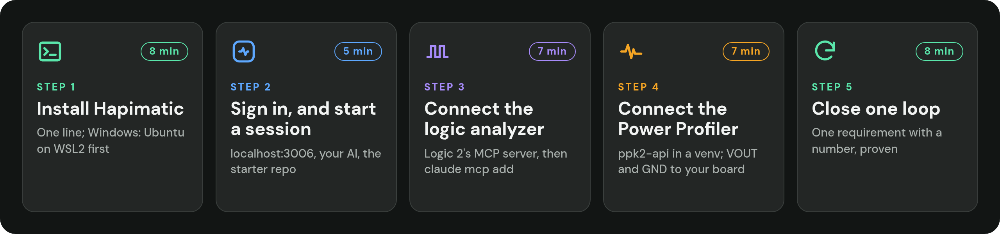
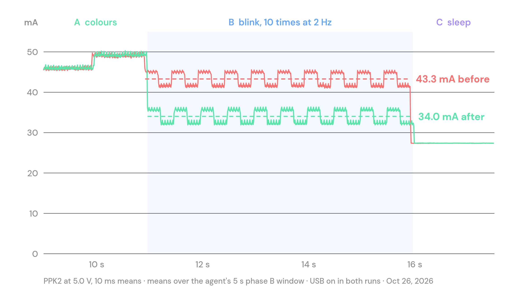

<p align="center">
  
</p>

<p align="center">
  <a href="https://hapimatic.com/talks/closing-the-loop-ese5180/tutorial.html"> <b>The tutorial</b></a> &nbsp;·&nbsp;
  <a href="https://hapimatic.com/talks/closing-the-loop-ese5180/"> <b>The talk</b></a> &nbsp;·&nbsp;
  <a href="https://hapimatic.com/talks/closing-the-loop-ese5180/links.html"> <b>Links page</b></a> &nbsp;·&nbsp;
  <a href="https://hapimatic.com"> <b>Hapimatic</b></a> &nbsp;·&nbsp;
  <a href="https://solidpd.com/"> <b>Solid Product Design</b></a>
</p>

<p align="center">
  <a href="https://ese5180.seas.upenn.edu/"> University of Pennsylvania · ESE 5180: IoT Wireless, Security, &amp; Scaling</a>
</p>

Let a coding agent close the hardware loop on your bench: **write the pass test, change the firmware,
flash, measure with a Saleae and a Nordic PPK2, then prove or revert**. Made for the teams in Penn's
[ESE 5180](https://ese5180.seas.upenn.edu/), and useful on any bench with those two instruments.

This is the kit from the bench run of 2026-10-26: Claude Code in WSL2 on a Windows laptop met both
closed-loop requirements on a real board, one prompt each ([the worked example](#what-it-did-on-a-real-board)).

## Contents

- [The loop](#the-loop)
- [The tutorial, five steps](#the-tutorial-five-steps)
- [What's in this repository](#whats-in-this-repository)
- [What it did on a real board](#what-it-did-on-a-real-board)
- [What has been tested](#what-has-been-tested)
- [Traps we hit](#traps-we-hit)
- [Every link](#every-link)

## The loop

<p align="center"></p>

The agent writes down what "done" means as a number **before** it touches the code, then changes one
thing, flashes, measures with real instruments, and either commits with the numbers or reverts and says
why. Your job is the requirement, and the yes before power.

## The tutorial, five steps

<p align="center"></p>

The same steps, in the same order, as the talk. [The tutorial page](https://hapimatic.com/talks/closing-the-loop-ese5180/tutorial.html)
has every screen from the slides beside each line; the lines below are the same, to copy. This is new
and experimental: a step may fail on your machine, and the lessons hold even when one does.

### 1. Install Hapimatic &nbsp;<sub><a href="https://hapimatic.com/talks/closing-the-loop-ese5180/tutorial.html#step-1"> on the tutorial page</a></sub>

**Linux:** run it as is. **Windows:** Ubuntu on WSL2 first, with two settings (mirrored networking, no idle
timeout): the two-page [WSL2 and boards guide](docs/wsl2-and-boards-guide-v2.pdf) and
[the WSL2 part of the tutorial](https://hapimatic.com/talks/closing-the-loop-ese5180/tutorial.html#on-windows).
**macOS:** a build ships, untested by us; the safe path today is to skip to step 3, where your agent drives
Logic 2 and the PPK2 directly.

```bash
# your agent (Codex and Gemini CLI work too); run it once to sign in
curl -fsSL https://claude.ai/install.sh | bash
claude

# Hapimatic
curl -fsSL https://github.com/SolidPD/hapimatic-core/releases/latest/download/install-hapimatic-v1.sh | bash

# the server prints your access token once: save it
hapi server
# in a second terminal
hapi daemon start
```

### 2. Sign in, and start a session &nbsp;<sub><a href="https://hapimatic.com/talks/closing-the-loop-ese5180/tutorial.html#step-2"> on the tutorial page</a></sub>

The token also lives in `~/.hapi/settings.json`, and this line prints it again:

```bash
jq -r .cliApiToken ~/.hapi/settings.json
```

1. Open **localhost:3006** in your browser, paste the token, and sign in.
2. **Sign in to your AI provider:** Settings › Provider Accounts › Anthropic › Add account, then Open sign-in
   link. On claude.com: your email, then the 6-digit code it emails you. Then Authorize, and copy the long
   code. Back in Hapimatic, paste the whole code, including the part after `#`, and press Done. It works once.
3. **New Session**, then **Browse**: pick your copy of this repository and Select. Create, with Claude Code as
   the CLI Harness.
4. Send it, and read the answer:

```text
Read AGENTS.md and BENCH.md, then tell me what you need from me to close a loop on my board
```

<details>
<summary><b>No Claude plan? Five routes, ranked</b></summary>

1. **Claude Code:** a Claude plan (the steps above), or an Anthropic API key in the same box; tested most.
2. **Codex:** install it with OpenAI's installer **before** Hapimatic, then sign in with `codex login` in a terminal, because the in-app sign-in is being fixed.
3. **An OpenRouter key:** paste it in Provider API Keys, and it runs OpenCode on the model you choose; OpenCode's qualification is pending.
4. **Gemini CLI:** a Google AI Studio key, whose Flash models have a free tier; it passed the bench loop.
5. **A local model:** free and slow, experimental; alone it failed 0 of 8, and with a frontier model reviewing it passed 3 of 3.

**Codex, step by step** ([on the tutorial page](https://hapimatic.com/talks/closing-the-loop-ese5180/tutorial.html#codex)):

```bash
# before you install Hapimatic, so Hapimatic finds it
curl -fsSL https://chatgpt.com/codex/install.sh | sh
codex --version
```

If you use the systemd services, add this line under `[Service]` in both units (`hapimatic-server.service`
and `hapimatic-daemon.service`), then reload and restart. If you run `hapi server` in a terminal, just
restart it.

```ini
Environment=PATH=%h/.local/bin:/usr/local/bin:/usr/bin:/bin
```

```bash
systemctl --user daemon-reload && systemctl --user restart hapimatic-server hapimatic-daemon
```

In ChatGPT: Settings › Security › enable device code login (a school workspace needs its admin to allow
it; if it won't, use an OpenAI API key). Then sign in from your terminal and finish the ChatGPT sign-in it
opens; Hapimatic reads that login:

```bash
codex login
```

</details>

### 3. Connect your agent to the logic analyzer &nbsp;<sub><a href="https://hapimatic.com/talks/closing-the-loop-ese5180/tutorial.html#step-3"> on the tutorial page</a></sub>

 In Logic 2 (2.4.48 or newer): the
**Automation** button at the bottom right, or Settings › Automation. **MCP Server on: 127.0.0.1:10530.**
In your session's **Terminal** tab, paste, press Enter, and stay there for the reply (Codex: the second line):

```bash
claude mcp add --transport http -s user logic2 http://127.0.0.1:10530
codex mcp add --url http://127.0.0.1:10530 logic2
```

For Gemini CLI, add the same URL as an HTTP MCP server in its settings.

**Wiring:** nRF7002 DK, channel 0 on P1.06 (LED1) and its ground lead on GND. Another board: any pin your
firmware toggles, and ground to ground. Back on **Chat**, send it; it lists your Logic, captures, and says
what channel 0 did:

```text
List my Saleae devices, then capture two seconds on channel 0 and tell me what you see
```

### 4. Connect the Power Profiler &nbsp;<sub><a href="https://hapimatic.com/talks/closing-the-loop-ese5180/tutorial.html#step-4"> on the tutorial page</a></sub>

 **Windows:** install nRF Connect for Desktop
first (the driver), then this block in PowerShell; Ubuntu cannot see USB.

```powershell
py -m venv $HOME\ppk2-venv
& $HOME\ppk2-venv\Scripts\pip install ppk2-api==0.9.2
```

**Mac:**

```bash
python3 -m venv ~/ppk2-venv
~/ppk2-venv/bin/pip install ppk2-api==0.9.2
```

Plug in its USB and check it is seen: it prints a port, such as `['COM6']` (Mac: use `~/ppk2-venv/bin/python`):

```powershell
& $HOME\ppk2-venv\Scripts\python -c "from ppk2_api.ppk2_api import PPK2_API; print(PPK2_API.list_devices())"
```

First fill in the **Power** line in [`AGENTS.md`](AGENTS.md): source mode at 3600 mV (DK, XIAO) or ampere
mode (Nucleo). The agent asks before it powers the board. Then, back on **Chat**:

```text
Measure my board through the PPK2 for ten seconds, save it to current.csv, and give me the average and the peak
```

#### Put the PPK2 on your board &nbsp;<sub><a href="https://hapimatic.com/talks/closing-the-loop-ese5180/tutorial.html#your-boards"> with photos</a></sub>

| Board | PPK2 mode | Wiring | Flash |
| --- | --- | --- | --- |
| **nRF7002 DK** | source meter, 3.6 V | 1. pull the jumper cap off **P23** (VBAT); 2. VOUT → **P23 pin 1, upper**; 3. GND → **P21 pin 1 (−)**. Measures the nRF7002 Wi-Fi chip; the nRF5340, on P22, needs SB16 cut and SB17 soldered first | `nrfutil` or `west flash`, onboard J-Link |
| **XIAO nRF52840** | source meter, 3.6 to 3.8 V | 1. flash it, then unplug USB, so you measure the board and not its charger; 2. VOUT → **BAT+**; 3. GND → **BAT−**. About 2 to 5 µA asleep, as XIAO owners report | double-tap reset, copy the `.uf2` |
| **Nucleo-WL55JC** | ampere meter | 1. USB powers the board; pull jumper **JP1** (I_SoC); 2. VIN → **JP1, 3V3 side**; 3. VOUT → **JP1, STM32 side**. With JP1 off, the 3V3 side reads 3.3 V to GND; PPK2 GND to any board GND | `STM32_Programmer_CLI`, onboard ST-LINK |

 **Before you clip onto the nRF7002 DK, read
the pin-1 marker on the silkscreen:** the lower P23 pin is the DK's own VBAT supply. **Powering the board
needs a teammate's yes; measuring doesn't.**

To check this repository's PPK2 tools on their own, use a 1 kΩ resistor as the load (about 3.3 mA):

```bash
python tools/ppk2-power-v1.py on 3300    # keep this running
python tools/ppk2-power-v1.py status
python tools/ppk2-power-v1.py off
```

### 5. Close one loop &nbsp;<sub><a href="https://hapimatic.com/talks/closing-the-loop-ese5180/tutorial.html#step-5"> on the tutorial page</a></sub>

Paste [`prompts/feature-v1.md`](prompts/feature-v1.md), fill in one requirement with a number, and prove it:
the pass test first, then change, build, flash, measure on the Saleae and the PPK2, decide pass or fail,
commit or revert, and report the numbers. It worked when there is a commit with the numbers in it, or a
revert with the reason. For a low-power change, with PPK2 numbers before and after, paste
[`prompts/low-power-v1.md`](prompts/low-power-v1.md).

Before you trust a loop, ask [five questions](https://hapimatic.com/talks/closing-the-loop-ese5180/tutorial.html#checklist).

## What's in this repository

| Path | What it is |
| --- | --- |
| &nbsp; [`AGENTS.md`](AGENTS.md) | The instructions your agent follows: the loop, the tools, the rules. Fill in the `<...>` fields for your board. Codex reads it directly; [`CLAUDE.md`](CLAUDE.md) and [`GEMINI.md`](GEMINI.md) import it |
| &nbsp; [`BENCH.md`](BENCH.md) | One row per instrument: how the agent reaches it, its hardware check, its limits, the last check |
| &nbsp; [`prompts/`](prompts/) | Two prompts to paste, with the requirement left blank: [a feature](prompts/feature-v1.md) validated with the Saleae, and [a low-power change](prompts/low-power-v1.md) with PPK2 numbers before and after |
| &nbsp; [`tools/ppk2-power-v1.py`](tools/ppk2-power-v1.py) | Keeps the PPK2 powering (or metering) your board while you flash and capture; `on`, `status`, `off` |
| &nbsp; [`tools/ppk2-capture-v1.py`](tools/ppk2-capture-v1.py) | Powers or meters the board for N seconds and saves the current to CSV, with a per-second summary |
| &nbsp; [`tools/logic-edges-v1.py`](tools/logic-edges-v1.py) | Edge counts, pulse widths, and frequency for every channel of a Logic 2 CSV export |
| &nbsp; [`tools/ws2812-decode-v1.py`](tools/ws2812-decode-v1.py) | An example protocol decoder for a Logic 2 export (WS2812 pixel data) |
| &nbsp; [`docs/wsl2-and-boards-guide-v2.pdf`](docs/wsl2-and-boards-guide-v2.pdf) | Two pages: running Hapimatic on Windows with WSL2, and putting the PPK2 on the nRF7002 DK, the XIAO BLE Sense, and the Nucleo LoRa board |
| &nbsp; [`examples/fabbit-2026-10-26/`](examples/fabbit-2026-10-26/) | The worked example: both pass tests, the decoded Saleae frames, the PPK2 analyses before and after |
| &nbsp; [`captures/`](captures/) | Where your agent saves its captures |

To use it, clone it next to your firmware (or copy `AGENTS.md`, `CLAUDE.md`, `GEMINI.md`, `BENCH.md`, and
`tools/` into your project) and fill in the `<...>` fields.

### Where to run the agent

- **[Hapimatic](https://hapimatic.com)** ([open-source core](https://github.com/SolidPD/hapimatic-core), Linux; on Windows via WSL2 with the guide in `docs/`): runs Claude Code, Codex, and Gemini CLI sessions you can watch and steer from a browser or phone.
- **Directly** in a terminal with Claude Code, Codex, or Gemini CLI. On a Mac, Logic 2's MCP server and ppk2-api both run, so the agent drives them directly.

## What it did on a real board

<p align="center"></p>

| Requirement | Pass test (written first) | Measured | Time |
| --- | --- | --- | --- |
| Feature: add a magenta step after white; step every 500 ms instead of 1250 ms | 10 frames, the GRB bytes in order, every gap 500 ± 5 ms | 10 frames in order, every gap 500.458 to 500.462 ms | 3.5 min |
| Low power: cut the blink phase by at least 5 mA; keep 10 blinks at 2 Hz | before measured first: 43.3 mA; after ≤ 38.3 mA; on and off 250 ± 5 ms | 34.0 mA (9.3 mA saved); on 249 to 254 ms, off 247 to 253 ms | 13 min |

Claude Code in WSL2 on a Windows 11 laptop, an original Saleae Logic, a PPK2 in source mode at 5.0 V, and
an ATmega328P test board. The files, and what went wrong first, are in
[`examples/fabbit-2026-10-26/`](examples/fabbit-2026-10-26/).

## What has been tested

| | Tested | Not yet tested |
| --- | --- | --- |
| Agent | Claude Code (in WSL2 on Windows 11) | Codex, Gemini CLI |
| PPK2 | source mode, Windows Python called from WSL2 | `--ampere`, Linux and macOS hosts |
| Saleae | an original Saleae Logic through Logic 2.4.48's MCP server | Logic 8, Pro 8, Pro 16 |
| Boards | an ATmega328P test board (Arduino CLI) | the nRF7002 DK, the XIAO BLE Sense, the Nucleo LoRa board |

## Traps we hit

-  The PPK2 turns its output off when its serial port closes. Keep `ppk2-power-v1.py on` running while you flash.
-  A killed PPK2 run leaves the stream on, and the next script fails with `UnicodeDecodeError`; the tools here drain it first.
-  On Windows, programs called from WSL read the rest of a piped script from stdin: run them with `</dev/null`.
-  A USB cable or a debugger on the board adds its own current. Measure low power with both removed, or say they were there.

## Every link

| Link | What it is |
| --- | --- |
| &nbsp; [The tutorial](https://hapimatic.com/talks/closing-the-loop-ese5180/tutorial.html) | Every step from the talk, with the same screens and the same lines to copy |
| &nbsp; [Closing the Loop](https://hapimatic.com/talks/closing-the-loop-ese5180/) | The talk: every slide, in your browser |
| &nbsp; [Links page](https://hapimatic.com/talks/closing-the-loop-ese5180/links.html) | Everything from the talk on one phone page, and a form that reaches Matt |
| &nbsp; [WSL2 and boards guide](docs/wsl2-and-boards-guide-v2.pdf) | Hapimatic on Windows, and the PPK2 on three boards |
| &nbsp; [ESE 5180](https://ese5180.seas.upenn.edu/) | University of Pennsylvania: IoT Wireless, Security, &amp; Scaling |
| &nbsp; [hapimatic.com](https://hapimatic.com) | Hapimatic: watch and steer agent sessions from a browser or phone |
| &nbsp; [SolidPD/hapimatic-core](https://github.com/SolidPD/hapimatic-core) | Hapimatic's open-source core (AGPL-3.0) |
| &nbsp; [Solid Product Design](https://solidpd.com/) | The product design firm behind this kit; [agentic engineering](https://solidpd.com/agentic) |
| &nbsp; [Matt Starfield on LinkedIn](https://www.linkedin.com/in/mattstarfield) | Senior Electrical Engineer, Solid Product Design |
| &nbsp; [Saleae Logic 2 MCP server](https://docs.saleae.com/mcp/guides/getting-started) | Saleae's guide to the MCP server step 3 turns on |
| &nbsp; [ppk2-api 0.9.2](https://pypi.org/project/ppk2-api/0.9.2/) | The PPK2's Python package, the version this kit was tested with |

---

<sub>MIT licensed. From Matt Starfield, the Senior Electrical Engineer at
[Solid Product Design](https://solidpd.com/). ESE 5180 is a course at the University of Pennsylvania;
this kit was made for a guest lecture there and is not a Penn publication.</sub>
